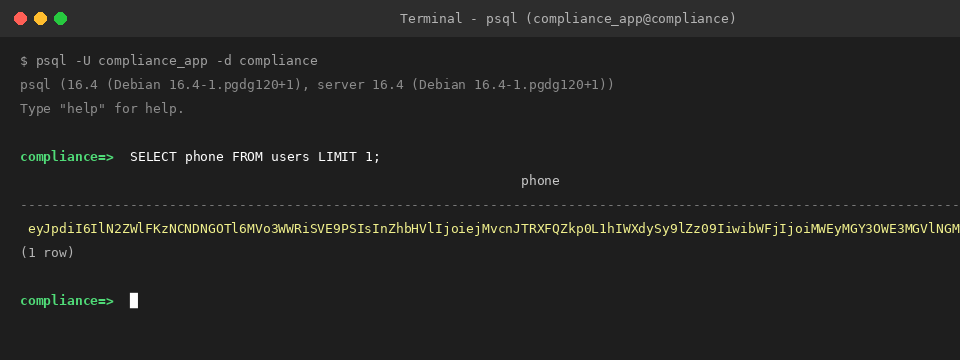

# Sensitive Personal and Organizational Fields Protection Policy

| Field | Value |
|---|---|
| Status | Approved |
| Jira Task | CMP-39 |
| Related Requirements | NFR-001 |
| Blocked by | CMP-06 |
| Target Environment | Production / Staging / Local |

---

## 1. Goal and Overview

The goal of this policy and implementation is to protect sensitive personal and organizational data stored in the database, ensuring that an unauthorized individual or an actor with direct read access to the underlying PostgreSQL database (e.g. storage dumps, SQL injection, unauthorized database access) cannot read sensitive data in plain text.

---

## 2. Sensitive Fields Inventory and Protection Mechanisms

The following table catalogs every sensitive personal, organizational, and authentication field within the compliance platform, along with its sensitivity classification and exact protection mechanism.

| Field | Table | Classification | Protection Mechanism |
|---|---|---|---|
| `phone` | `users` | PII (Personally Identifiable Information) | Encrypted at rest via Laravel 11 encrypted Eloquent cast (`AES-256-CBC` with `APP_KEY`). Excluded from raw model serialization via `$hidden`. Masked in user interfaces and API Resources as `*** *** 1234` (revealing only the last 4 digits). |
| `email` | `users` | PII / Unique Identifier | Stored in plain text to allow database uniqueness indexing and user authentication lookups. Access is protected by strict role-based access control (RBAC): only Administrators can list user accounts. Never logged in application log files. |
| `password` | `users` | Authentication Secret (High) | Irreversibly hashed using Bcrypt / Argon2id (`hashed` Eloquent cast, per CMP-08). Never encrypted, never stored in plain text, never returned by any API endpoint, and excluded from serialization via `$hidden` and log outputs. |
| `legal_representative_name` | `organizations` | Organizational Legal Information / PII | Encrypted at rest via Laravel encrypted cast (`AES-256-CBC` with `APP_KEY`). Excluded from model serialization via `$hidden`. Whitelisted via API Resources only for authorized roles. *(Note: Field reserved for extended fiscal compliance profiles; catalog foundation defined in CMP-02)* |
| `tax_id` / `rfc` | `organizations` | Organizational Fiscal Secret | Encrypted at rest via Laravel encrypted cast (`AES-256-CBC` with `APP_KEY`). Excluded from model serialization via `$hidden`. Whitelisted via API Resources only for authorized roles. *(Note: Field reserved for extended fiscal compliance profiles; catalog foundation defined in CMP-02)* |
| `fiscal_address` | `organizations` | Organizational Legal / Location Info | Encrypted at rest via Laravel encrypted cast (`AES-256-CBC` with `APP_KEY`). Excluded from model serialization via `$hidden`. Whitelisted via API Resources only for authorized roles. *(Note: Field reserved for extended fiscal compliance profiles; catalog foundation defined in CMP-02)* |
| `responsible_user_id` | `compliance_requirements` | PII Reference / Access-controlled | Foreign key referencing `users.id`. Protected at the API Resource layer via RBAC: when retrieved by General Employees, the API returns only the responsible user's `name` (never email or phone). Contact details are restricted to Administrators and Compliance Staff. |
| `token` | `password_reset_tokens` | Authentication Credential | One-way SHA-256 hashed token with timestamp expiration. |
| `payload` | `sessions` | Session State / Token | Encrypted or restricted session storage; isolated to active session lifecycle. |

---

## 3. Cryptographic Implementation Details

### 3.1 Encryption Algorithm and Casts
- **Cipher**: `AES-256-CBC` configured in `config/app.php` (`cipher => 'AES-256-CBC'`).
- **Implementation**: Laravel 11 `encrypted` Eloquent casts (`'phone' => 'encrypted'`).
- **Encrypted Payload Format**: Laravel's encrypter serializes data into a JSON structure containing:
  - `iv`: Initialization vector (base64 encoded).
  - `value`: AES-256-CBC ciphertext (base64 encoded).
  - `mac`: Message Authentication Code computed via SHA-256 HMAC for integrity and authenticity verification.
  - `tag`: Empty string or AEAD tag.
  The entire payload is base64 encoded, producing a string starting with `eyJ` (e.g. `eyJpdiI6...`). Direct inspection in PostgreSQL (`psql`) verifies that plain text numbers are not visible:

  

### 3.2 Model `$hidden` Attributes and API Resources
- Models define sensitive attributes in `protected $hidden = [...]` so that direct serialization (such as `$user->toArray()` or `$user->toJson()`) never outputs plain text sensitive values.
- API Resources whitelist returned fields based on the authenticated user's role.
- For phone numbers, `UserResource` masks the value by extracting the last 4 digits and prefixing them: `*** *** 5678`.

---

## 4. Encryption Key Management and Key Rotation Procedure

The master application encryption key (`APP_KEY`) must reside **exclusively in the server `.env` file** and must never be committed to source control or logged in traces.

### 4.1 Key Rotation Architecture
Laravel 11 supports multi-key rotation through the `APP_PREVIOUS_KEYS` configuration. When decrypting a record, Laravel's encrypter first tries `APP_KEY`. If decryption fails (because the record was encrypted with a prior key), it attempts decryption using each key in `APP_PREVIOUS_KEYS` in order.

### 4.2 Key Rotation Step-by-Step Procedure

1. **Generate a new encryption key**:
   ```bash
   php artisan key:generate --show
   ```
   *Note down the generated key (e.g., `base64:NEW_KEY_HERE...`).*

2. **Update the server `.env` file**:
   Move the existing `APP_KEY` into `APP_PREVIOUS_KEYS` (comma-separated if multiple previous keys exist), and assign the new key to `APP_KEY`:
   ```dotenv
   # Previous primary key preserved for decryption:
   APP_PREVIOUS_KEYS=base64:OLD_PRIMARY_KEY_HERE...

   # New primary key for future encryptions:
   APP_KEY=base64:NEW_KEY_HERE...
   ```

3. **Verify application functionality**:
   Run automated test suite and check that existing encrypted records decrypt seamlessly.

4. **Re-encrypt existing records (optional background maintenance)**:
   For models with encrypted attributes, load and re-save the records so they are stored with the new `APP_KEY`:
   ```php
   User::chunk(100, function ($users) {
       foreach ($users as $user) {
           if ($user->phone) {
               $user->phone = $user->phone; // Re-triggers encrypter with active APP_KEY
               $user->saveQuietly();
           }
       }
   });
   ```

5. **Decommission old keys**:
   Once all database records have been re-encrypted with the new key, remove the retired key from `APP_PREVIOUS_KEYS`.

---

## 5. Application Logging Security and Grep Verification

Application logs must never record personal contact information or authentication secrets.

### 5.1 Redaction Processor
A Monolog log processor (`App\Logging\SanitizeSensitiveDataProcessor`) is registered on logging channels to automatically inspect and redact:
- Context keys matching `password`, `password_confirmation`, `phone`, `email`.
- Regular expression patterns matching email addresses and phone numbers.

### 5.2 Verification Grep Check
To verify that no plain text email, phone, or password values exist in log files, execute:

```bash
grep -Ei "password|phone|[a-zA-Z0-9._%+-]+@[a-zA-Z0-9.-]+\.[a-zA-Z]{2,}" storage/logs/laravel.log
```

If the command returns no matches, or if matches show only sanitized placeholders (e.g. `[REDACTED]`), the log file passes compliance.
